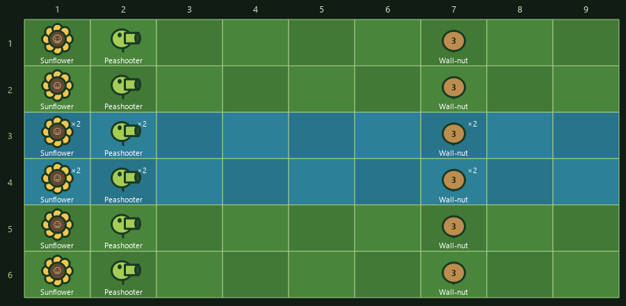

# LawnLab 5.5 — how to use the tools

Open PVZ, start a battle, close its menus and connect LawnLab. The battle must be running for timed effects, shooting, pickup animations and spawn queues to advance. Use **Play in background** if you want PVZ to keep updating while you work in Studio. In-app instructions appear at the top of every Studio tab; hovering an inspector field explains its units and limits.

## Coins, hits, rows and firing

**Auto collect coins** collects ordinary silver coins, gold coins and diamonds already on the lawn or dropped during battle. It invokes PVZ's normal collection routine, so coins fly to the bank and pay their normal value. It does not collect level-ending trophies, seed cards or plant gifts. **Auto collect** is the separate sunshine control. If Coin balance lock is enabled, earnings cannot raise that locked balance; turn the lock off to see normal earnings.

**One-hit knockout** now bypasses head and held protection when a positive damage hit reaches a zombie. It does not pre-damage every zombie when enabled. A shot must still be able to hit its target: an ordinary pea cannot hit every flying or underground state. Invincible zombies is mutually exclusive with this control.

For **existing zombies**, choose a destination on **Move existing zombies** and press **Move zombies now**. Their horizontal positions stay the same. Walking/eating zombies can move between compatible rows; special animation states, bosses and land/water crossings are skipped and counted in the result. To move just one, select it in **Inspect & edit**, choose its destination row and press the selected-zombie move button.

**Choose a lane** also moves compatible current zombies when enabled, then directs newly initialized zombies into the chosen row. With that toggle active, Move existing zombies changes its selected future lane as well. Turning it off does not move zombies back.

**Rapid fire** uses a direct-fire path for standard shooters, with a five-tick launch interval: up to **20 shots per second at normal pace**. Multilane/burst plants retain parts of their native attack patterns. Accelerated shooting pauses when the projectile pool is busy, leaving room for the game's other projectiles. Changing Game pace changes how quickly game ticks pass.

**Firing delay** is a different mode for adjusting animated attacks. Its range is **1–255 game ticks**. At normal pace, 100 ticks is about one second; 255 is about 2.55 seconds. Lower values are faster, but the animation must finish before the next attack starts. A value of 1 does not promise 100 visible shots per second. Use Rapid fire for direct shooting. Enabling either mode disables the other.

## Sunflower drops

In the main window’s Plants category, choose **Sunflower drops**: normal sun, silver coin, gold coin or diamond, then enable it. Future production from Sunflower and Twin Sunflower uses that object. Twin Sunflower still makes two drops. Sky sun, zombie loot, Sun-shrooms and Marigolds are unchanged. Turn it off for normal production; existing drops keep their type. Enable Auto collect coins to bank the coin drops. Disable Coin balance lock to see earnings; PVZ normally caps the bank at $999,990.

## Lawn builder: one plant or many

1. Choose a named plant. Names include the game's type ID for reference.
2. Choose a placement area: **Selected rectangle**, **Fill all available lawn cells**, or **Place a total quantity across the lawn**. For the third mode, set Total quantity; it counts the chosen plant, excluding any automatically added foundations. Cells are scanned row by row, left to right. An insufficient-space request is rejected before anything is created. Whole-lawn aquatic planting uses water rows only. For rectangle mode, set a row range and column range. Rows are numbered top to bottom, columns left to right. Matching From/To values select one cell. Rows 1–2 and columns 1–3 select six cells.
3. Leave Copies at 1 for one plant per selected cell. Tick **Allow ordinary plants to share a cell** and choose 2–8 copies for stacks. This does not support duplicate lily pads, pots, pumpkins, coffee beans or cob cannons.
4. **Skip occupied cells** fills gaps while preserving current plants. It is disabled for stacking, because stacking intentionally shares occupied cells.
5. **Add needed lily pads / flower pots automatically** supplies foundations for water and roof cells. Aquatic plants still need water rows.
6. Press **Place plants using selected area / quantity**. The whole layout is checked before placement starts. Studio allows up to 250 live plants; a failed native creation reports the number already created.

Cob cannons occupy two columns; their rectangle advances by two columns. No placement removes another plant automatically. Created plants remain when you use Reset all.

## Paint a visual lawn, then save or build it

Press **Open the visual lawn planner below**, choose a named brush plant, and click cells on the game-shaped lawn grid. Row 1 is the top; column 1 is the left. Pool/Fog has six rows and blue water lanes; Roof has a tile background. Sunflower and Peashooter have small original vector illustrations; other plants use named type markers. This is a planning grid, not a live game screenshot. Hover any cell for full names and IDs.

Right-click a cell, or enable Eraser and click it, to remove its planned plants. Click-painting replaces that cell’s planned main plant unless stacks are enabled. Pool and roof supports are added automatically. The table below offers exact type/row/column/copy editing and is synchronized with the grid. Editing the plan never changes PVZ until Build is pressed.

## Prepare and save a plant plan

Use **Add rectangle to saved plan**, or add rows directly to the plan table. Each row selects a named plant, a row, a column and the number of copies. Adding a plan row does not plant anything.

**Plan terrain does not change the live game.** It selects the saved plan’s compatible lawn and the grid’s background. Use a matching Adventure/Survival stage to play on that terrain, or press **Use current scene** to match the active lawn. For a live pool lawn, for example, launch Survival Pool in Stages & Zen Garden; changing Plan terrain to Pool does not convert a day battle. Saved layouts require that scene's terrain. Include lily pads before ordinary plants in pool cells and pots for roof plants. The saved plan is sorted so foundations are created first.

Give the plan a name and press **Save plan**. Later, select it and use **Load plan for editing**. Press **Build displayed plan** to create what is currently in the table, or **Build selected saved file** to create the file directly.

With **Add to current lawn** checked, existing plants are preserved and identical planned cells are skipped. A different plant in the same cell blocks the plan unless ordinary-plant stacking is enabled. An unchecked Add option requires an empty lawn. Repeatedly building a stack adds copies until the eight-per-cell limit is reached.

**Capture current lawn to file** saves the plants already in the battle, including ordinary stacked plants. It does not capture zombies, sun, wave progress or temporary status timers.

## Spawn and save zombies

On Lawn builder, choose a named zombie, row, quantity and gap in milliseconds, then **Start spawning**. A 1,000 ms gap means one zombie per real-world second. **Cancel queue** stops zombies that have not yet spawned; it does not remove those already present.

To save this single group, enter a setup name and press **Save this zombie group**. Select it later under Saved zombie setups and press **Spawn saved setup**.

For mixtures, use **Mix several zombie types** to open Zombie waves. Those saved setups appear in both tabs. Dr. Zomboss is excluded because he requires the dedicated boss stage. Water-only zombies require pool rows; unsupported terrain is rejected before the relevant spawn.

## Inspect & edit: what the numbers mean

Choose Plants or Zombies, press **Refresh live objects** and select a row. The type is the species: **Conehead (ID 2)** means a conehead zombie. The **instance number** identifies one particular live object, not a species. Refresh after a death or a lawn change; the backend refuses stale instances.

| Field | Meaning |
| --- | --- |
| Current health / Maximum health | Remaining body HP and its ceiling. Tick Maximum health and raise it first if you want Current health above the previous limit. |
| Helmet durability | HP of existing head protection: a cone, bucket, football helmet, etc. The inspector separately names its equipment type and ID. |
| Held shield durability | HP of an existing screen door, newspaper or ladder. This is separate from helmet and body HP. |
| Action countdown | Ticks until the next applicable attack or production action. Producers are labeled as sun/coin timers. A countdown is not damage. |
| Base action interval | Base ticks between actions. Some plants randomize it. Global Rapid fire/Firing delay can override shooter timing. |
| Walking speed | Pixels per tick, 0–5. A normal zombie is often near 0.3; 0 stops ordinary horizontal movement. Special animations may control movement independently. |
| Slow / butter / freeze duration | Remaining game ticks for that status. 0 clears it; 100 ticks is about one second at normal pace. |

Only fields that apply to the selected object are available. A bare-headed zombie has no helmet controls. Editing helmet HP does not change a normal zombie into a Conehead: spawn the named equipped type instead. Wall-nuts do not get unused shooter-timing inputs.

Tick only the fields you intend to edit, then **Apply checked changes**. Current HP cannot exceed its matching maximum. **Restore reversible Studio edits** restores journaled fields on the same still-live instances; it cannot resurrect an object or undo creation/deletion.

## Zombie waves: schedules versus game wave numbers

A practice setup is a list of timed groups. For example:

| Zombie group | Lane | Quantity | Gap | Start delay |
| --- | --- | --- | --- | --- |
| Basic zombie (ID 0) | 1 | 5 | 1,000 ms | 0 ms |
| Conehead (ID 2) | 3 | 2 | 2,000 ms | 3,000 ms |

The first group starts immediately and the second starts three seconds later. Groups share one clock and may overlap. Save stores the setup; Load changes the table without spawning; Spawn this setup starts it. Intervals use real time, so Game pace does not change the queue's wall-clock timings. At most 500 zombies can be queued in a setup, with four due spawns processed per timer tick. Leave Studio open; closing it, changing lawns or Reset all cancels the queue.

**Replace an upcoming natural wave** is separate. Pick a future wave number and add named zombie groups to its list, up to 50 entries. Applying changes that future built-in wave's composition; it does not spawn it immediately or assign lanes. PVZ normally picks those lanes unless Choose a lane is active. To advance the next built-in wave, resume the battle, disable Pause spawning and use the main window's Spawn the wave action.

## Seeds & shots

**Seed packets:** Slot 1 is the leftmost card at the top of PVZ. Read the current cards, choose an existing slot and named plant, then Apply to selected seed slot. This changes that card, not plants already on the lawn. An Imitater card copies the named target. Duplicate testing allows the same plant in several slots. Recharge counters are game ticks; resume to see the card update.

**Projectile effects:** Select an effect and read its explanation, then apply it to future shots. Snow peas slow; butter stuns; Winter Melon splash slows rather than hard-freezing. Melon and fire use their native impact behavior. This does not create a firing plant, and already-flying projectiles keep their current type. The main Projectile changer and Studio effects share one setting.

**Shared damage:** Choose a projectile and damage from 0–100,000 HP per hit. Zero means no damage. The table is global for that projectile type, including matching zombie weapons. One-hit knockout and Invincible zombies override normal damage results. Reset restores the shared table, but cannot undo damage already dealt.

## Stages & Zen Garden

Adventure stage numbers 1–50 mean 1-1 through 5-10; the interface shows the conversion. A Survival or Garden mode ignores that Adventure number. Launch from the main menu, or close PVZ menus and resume the current lawn before launching. Active controls are reset first. The transition disposes the old board under its original mode and loads the new mode on PVZ’s own thread. Launch replaces the current lawn and may replace a saved run. Adventure launch also changes progress. A save backup and confirmation come first.

For Zen Garden, press **Read saved garden collection** and select a named plant. Garden slot 0 means the first saved potted plant; it is not Peashooter's type ID 0. Garden and current need use names instead of raw enums.

* **Water now** records watering and increments this plant's feed count.
* **Fertilize now** advances growth only after enough water feeds and only before maturity. The button is unavailable when that requirement is not met. Read the collection again after watering to refresh eligibility.
* **Growth stage** chooses Sprout, Small, Medium or Mature directly.
* **Garden supplies** is the displayed count, 0–999, for fertilizer, bug spray, chocolate or tree food.

Garden actions are saved changes. Read the collection again after editing; re-enter Zen Garden to refresh its visual display. A backup of on-disk saves is created before persistent actions.

## Backups and settings are different

Save backups contain PVZ progress files. Settings profiles contain trainer switches, parameter values and shortcuts. Plant plans contain lawn layouts. Zombie setups contain spawn schedules. Loading one does not load the others.

Older 5.2 settings profiles can load with the newly added controls off. One-time actions never auto-run from a settings profile, and hotkeys remain off until explicitly enabled. Restore game saves only while PVZ is closed.

## Garden batches and Player data — new in 5.5

Read [PROFILE-AND-GARDENS.md](PROFILE-AND-GARDENS.md) for saved slot selection, bulk care, adding/moving plants, shop restocking, achievement editing and named player-data fields. These saved changes are separate from trainer settings profiles and lawn plans. Adding/moving plants and editing player data require PVZ Main Menu.
