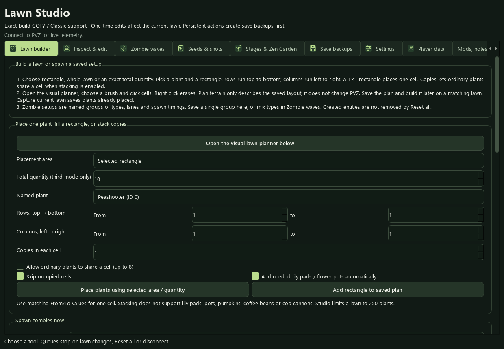

# Lawn Studio — LawnLab 5.6

Current compatibility and usage: [GOTY + Classic, Snail, Limbo, coin units, Tree height and Endless records](CLASSIC-AND-PROFILE-5.6.md). Both builds have their own CT/catalog; Classic has no native GOTY achievements.


Version 5.2 includes the gameplay corrections and live checks in [GAMEPLAY-FIXES-5.2.md](GAMEPLAY-FIXES-5.2.md), using the ownership/recovery runtime described in [STABILITY.md](STABILITY.md). Studio and the main controls share an operation lock. The feature guide below describes the Studio tools introduced in 5.0.

Open **Lawn Studio** from the main window's sidebar. The 43 main controls remain in their existing categories. Studio adds seven workspaces covering all 14 requested feature areas. New memory editors require the exact verified **GOTY 1.2.0.1073 x86** executable; opening Studio or loading a profile never attaches automatically or runs a scenario.



## Current step-by-step guide

Read **[LAWN-STUDIO-GUIDE.md](LAWN-STUDIO-GUIDE.md)** for the current 5.3 tab names, bulk and stacked placement, editable plant plans, reusable zombie setups, named inspector fields, valid inputs and worked wave examples. The following reference preserves the original feature overview; current UI labels and workflows are in that guide.

## Original feature reference

| Requested feature | Where and how to use it |
| --- | --- |
| Plant placement editor | **Lawn & formations**: choose a regular plant ID 0–47, row and column, then Place plant. Existing plants on the same layer are protected. Pool plants require appropriate rows/lily pads; roof plants require pots. Cob cannons occupy two columns. |
| Custom zombie spawner | Choose type, row, quantity and interval. Start spawning queues a bounded timed sequence. Cancel stops remaining entries. Special aquatic types require water rows; Dr. Zomboss is excluded from general spawning. |
| Formation presets | Capture the current lawn to a named JSON document, then rebuild it on an empty lawn with the same scene. Pads/pots are placed before main plants and pumpkins. Overlapping cells and missing terrain supports are rejected. Imitater transformations are currently excluded from rebuilding; such a layout produces an explicit error. |
| Entity inspector | **Entities & upgrades**: refresh plants or zombies, select a row to inspect the verified fields, check only the fields you intend to change, and Apply. Entity generation IDs and lawn identity prevent writing a reused slot. Refresh after replacing a lawn or losing an entity. |
| Plant upgrades | Edit selected plant health/maximum health, current attack timer and attack interval. Attack timing applies to shooting plants. Damage is shared by projectile type rather than a fabricated per-plant damage field. |
| Zombie modifiers | Edit body health, existing helmet/shield health and maxima, movement velocity, and chill/butter/freeze counters. Durations are game ticks. Raising health beyond its maximum requires editing the maximum too. Equipment HP does not create equipment on an unarmoured zombie. |
| Wave editor | **Waves**: build/save/load a composition with zombie ID, lane, quantity, interval and start delay. Run it independently of the normal level waves. A second editor replaces an upcoming natural wave's type list, up to 50 entries. Already spawned/past waves are protected. |
| Seed-bank editor | **Seeds & projectiles**: read the live bank, select an existing slot, change its plant or imitater target, and apply. Duplicate testing requires explicit opt-in. Conveyor/custom banks without a valid standard layout are refused. |
| Projectile effects | Enable native chilling, butter stun, melon splash, Winter Melon splash (slow) or fire splash behavior. Winter Melon slows rather than hard-freezing. Fire provides the game's fire-projectile behavior; this is not a new Cherry Bomb projectile or custom explosion engine. The control shares the creation-time projectile patch. Reset restores its previous mode. |
| Level selector | **Levels & Zen Garden**: select an Adventure stage 1–50, a Survival variant, or Zen Garden, then launch. This replaces the current lawn and can replace that mode's saved run. Adventure selection changes profile progress; selecting another mode does not rewrite the Adventure level. Confirmation and an automatic on-disk backup precede the call. |
| Zen Garden tools | Inspect the current profile's potted plants, choose a plant index, water/fertilize it, set growth 0–3, or change fertilizer/spray/chocolate/tree-food supplies. Fertilizing advances growth when the feeding threshold is reached. These edits are persistent, backed up and saved through the game's profile routine. Re-enter the garden to refresh its display. |
| Save backup and restore | **Save backups**: create checksummed snapshots of `users.dat`, `user*.dat` and `game*_*` saves. Choose the actual userdata folder if using a non-default installation. Restore requires PVZ closed, validates all files first and creates a recovery snapshot before replacing saves. |
| Profiles and hotkeys | **Profiles & hotkeys**: save the original controls' presets/states and configurable key bindings. Loading resets existing settings and leaves controls off by default. Optional activation runs only toggle controls; one-time actions are never auto-run. Hotkeys stay off after loading. |
| Live dashboard | The Studio header reports sun, current/total waves, live plant/zombie counts and remaining queued spawns. It refreshes while connected and distinguishes menus from a playing lawn. |

## Hotkeys

Enable configured hotkeys explicitly. Defaults:

| Key | Action |
| --- | --- |
| F6 | Toggle infinite sunshine |
| F7 | Toggle instant recharge |
| F8 | Toggle pause spawning |
| F9 | Toggle freeze zombies |
| F10 | Cancel Studio spawn queue |

Use F1–F12 with optional Ctrl/Alt/Shift. Alt+F4 is reserved for closing the game. Bindings use key-state reads, not injected keystrokes, keyboard interception, or a driver. They run only when the connected PVZ process has focus, trigger once per press, and ignore presses while another trainer operation is running. Equivalent duplicate bindings are rejected when saving/loading a profile.

## Local documents and backups

```text
%LOCALAPPDATA%\LawnLab\formations
%LOCALAPPDATA%\LawnLab\waves
%LOCALAPPDATA%\LawnLab\profiles
%LOCALAPPDATA%\LawnLab\backups
```

The default save source is `%PROGRAMDATA%\PopCap Games\PlantsVsZombies\userdata`. Backup manifests contain SHA-256 checksums. File names, paths, document sizes, counts and numeric fields are bounded; documents contain data, not executable scripts.

A backup made during play captures **on-disk saves**, not unsaved live memory. Closing PVZ first gives the most complete checkpoint. Restore is blocked while the game runs. Extra recognized save files absent from the selected snapshot are removed only after a full recovery snapshot has been created; unrelated files are preserved. Do not start PVZ during restoration. Backup, restore and persistent-edit errors are surfaced in Studio's status area.

## Reset behavior

Main-window **Reset all**, disconnect and closing Studio stop scheduled spawns, restore the owned projectile mode/shared damage settings, and restore journaled fields only on matching live entities from the same lawn. A slot whose generation ID changed is never restored. Lawn transitions also invalidate queues and selections; a decreasing lawn clock helps detect a reused board address.

Disable the original **Plant changer** before explicit placement, and **Choose a lane** before custom zombie spawning. Studio refuses these conflicting combinations instead of silently creating a different type or lane. Projectile effect controls share the original projectile changer; use one of those interfaces at a time.

Plant/zombie creation, formation rebuilding, seed-packet changes, natural wave lists, launched stages, saved garden changes, damage already dealt and consumed resources are **one-time effects**. Reset does not undo them. Use a new test lawn or the save-backup tools as appropriate.

The schedule permits at most 500 zombies per composition and four due spawns per timer tick. It is a practice scheduler, not a hard-real-time clock; busy operations and game transitions can delay/cancel entries. Formations never erase an existing lawn automatically; a failed native creation reports how many plants had been placed.

## Exact-build implementation

SHA-256: `1ff5a2dcf009b453b8866783a68e8d04bd0d066abda3f8196d75a677366b2dff`.
PE image size: `0x415000`. All addresses below are relative to the executable module unless otherwise stated.

| Object/routine | Verified layout |
| --- | --- |
| LawnApp root | RVA `0x329670` |
| Board / profile / UI | App offsets `0x868` / `0x94C` / `0x91C` |
| Plant array | Board `0xC4`, stride `0x14C`, dead `0x141`, generation ID `0x148` |
| Zombie array | Board `0xA8`, GOTY stride `0x168`, dead `0xEC`, generation ID `0x164` |
| Plant health / attack timing | `0x40`, `0x44` / `0x58`, `0x5C` |
| Zombie body / helmet / shield HP | `0xC8` / `0xD0` / `0xDC`; maxima at `0xCC`, `0xD4`, `0xE0` |
| Zombie shield type | `0xD8` is an enum and is never written as shield health |
| Seed bank | Board `0x15C`, packet stride `0x50` |
| Natural wave lists | Board `0x6CC`, 50 integers per wave |
| Sun / total waves / current wave | Board `0x5578` / `0x557C` / `0x5594` |
| Projectile damage definitions | RVA `0x31E900`, stride 12, damage +8; shared across matching projectiles |
| Potted plants | Profile count `0x378`, entries `0x380`, stride `0x58` |
| Plant factory | RVA `0xFA10` |
| Challenge zombie factory | RVA `0x2CC90`, challenge at Board `0x178` |
| Stage launcher / profile save | RVA `0x52820` / `0x52800` |
| Update-loop gate | Original `EB C8` at RVA `0x1D6C6D`; temporarily gated during native operations |

New native routines check expected instruction bytes before being called. Updates are gated while creating/editing entities, so the main update loop cannot simultaneously reuse a slot. Protected code writes restore page protection and flush the instruction cache. A completed call releases its temporary allocation. If a native call times out, executing memory is retained and the update gate stays blocked; restart PVZ instead of attempting more edits against an uncertain call.

Field layouts/calling conventions were cross-checked against [PvZ Toolkit's build data](https://github.com/lmintlcx/pvztoolkit/blob/master/src/data.cpp), its [game interface](https://github.com/lmintlcx/pvztoolkit/blob/master/src/pvz.cpp), the [GOTY-annotated LawnApp reconstruction](https://github.com/Patoke/re-plants-vs-zombies/blob/main/LawnApp.cpp), and reconstructed [entity/profile declarations](https://github.com/Electr0Gunner/PvZ-Reconstruction-BugFix/tree/main/Lawn). References were read as source; no downloaded trainer binary was executed.

## Validation

The original Studio suite added coverage to reach **42 passing offline tests**, including the interface/connection tests. Checks cover array bounds, stale IDs/lawns, checked-field edits, armour versus shield-type layout, seed duplication, future waves, shared damage restoration, profile/hotkey validation, scheduler bounds/cancellation, checksummed backups/recovery, refusing a restore while PVZ runs, native rollback and retaining executing memory on timeout. Version 5.1 adds the control-runtime checks recorded in [STABILITY.md](STABILITY.md).

Separate live checks on the fingerprinted build confirmed plant creation, zombie creation/counts, dashboard/seed/garden reads, plant field edits/restoration, seed write/read-back with restoration, shared damage edits/restoration, formation capture and upcoming-wave list edits/restoration. A real on-disk save backup was created before those checks. The 5.2 gameplay checks confirmed actual chill and butter counters after projectile impacts; splash behavior and visual appearance were not individually verified by window capture.

Stage launch and persistent garden writes have signature checks and simulated coverage; they were **not exercised against the user's saved progress**. Formation rebuilding on another live lawn, every special zombie/scene combination, and physical hotkey presses also remain subject to individual gameplay confirmation. Tests passing does not certify every gameplay effect. Version 5.1 applies the exact-build guard to both Studio and all main-window controls; additional executable builds are refused.


For separate edition saves, scrolling seed cards, note text and mod imports, see [the 5.7 guide](EXTENSIONS-AND-SAVES-5.7.md). These Studio workflows use the GUI; the CT retains the 46 main controls and includes their new address references.
