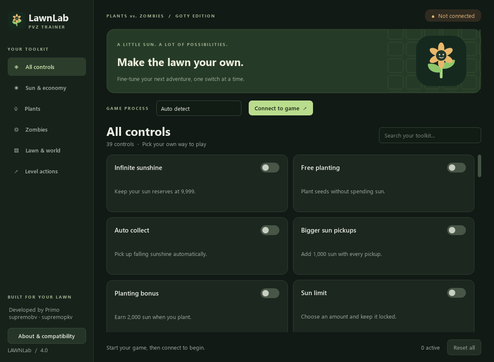
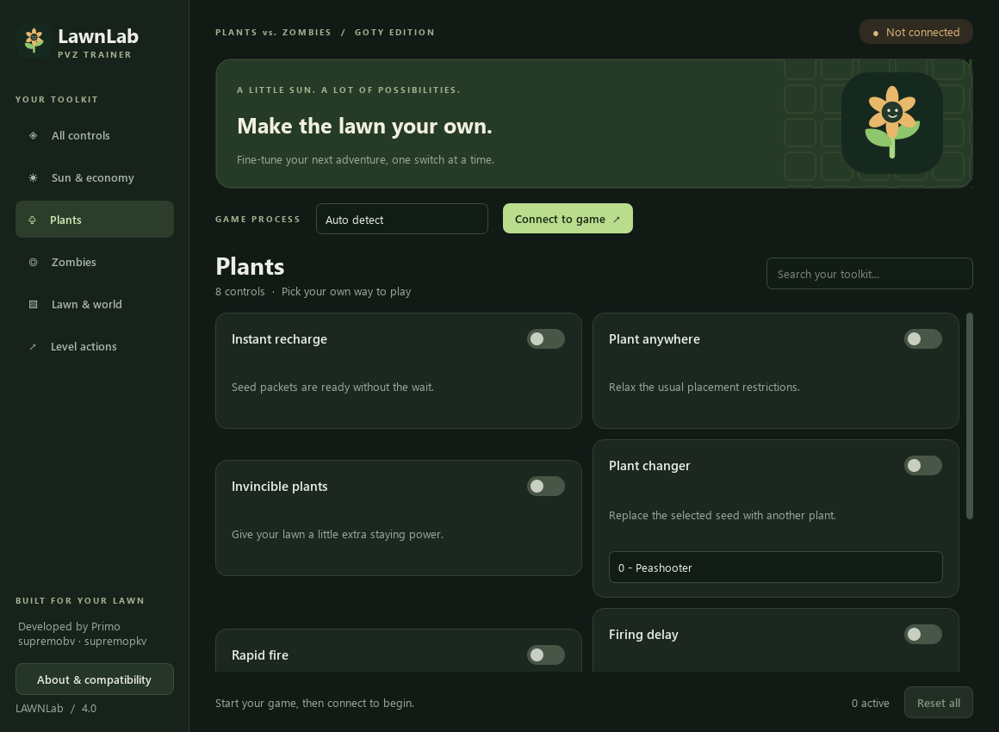

# LawnLab — PVZ Trainer

<p align="center">
  
</p>

<p align="center"><strong>A desktop toolkit for making the Plants vs. Zombies lawn your own.</strong></p>

LawnLab 4.0 gives PVZ Trainer a resizable Qt interface, searchable controls, a custom sunflower logo, and clearer connection and session handling. It retains the project's existing Python memory-patch routines.

**Developer and owner: Primo — [@supremobv](https://github.com/supremobv).** The earlier GitHub account, [@supremopkv](https://github.com/supremopkv), belongs to the **same developer**. References to either account describe the same project's author, not two separate developers or a third-party fork.



## Contents

- [Overview](#overview)
- [Requirements](#requirements)
- [Quick start from source](#quick-start-from-source)
- [Connecting to the game](#connecting-to-the-game)
- [Controls](#controls)
- [Session and reset behavior](#session-and-reset-behavior)
- [Building a portable Windows app](#building-a-portable-windows-app)
- [Tests and visual checks](#tests-and-visual-checks)
- [Compatibility and limitations](#compatibility-and-limitations)
- [Troubleshooting](#troubleshooting)
- [Project structure](#project-structure)
- [Contributing](#contributing)
- [Credits and license](#credits-and-license)

## Overview

- **39 controls** organized into sun/economy, plants, zombies, lawn/world, and level actions, plus an All controls view.
- Live text search across control names, descriptions, and categories.
- **Auto detect** checks `popcapgame1.exe` and `PlantsVsZombies.exe`; either can also be selected manually.
- Explicit connection, busy, and active-control indicators.
- Editors for sun, coins, plant and projectile types, lanes, firing delay, and game pace.
- Worker-thread execution keeps the interface responsive during engine operations.
- Failed toggles synchronize back to the state reported by the engine.
- Mutually exclusive modes avoid enabling conflicting sun, plant-health, and zombie-health settings together.
- Level-changing actions ask before they run.
- A separate legacy application remains available in `pvz_trainer.py`.

The trainer operates on the selected game's process memory. It does not install a kernel driver, change Windows security settings, or enable game modifications automatically at startup.

## Requirements

| Component | Requirement |
| --- | --- |
| Operating system | Windows 10 or Windows 11, 64-bit |
| Python for source runs/builds | Python 3.10 or later; locally tested with Python 3.14.3 |
| Interface | PySide6 Essentials / Qt 6 |
| Memory access | pymem 1.14 or later, below 2.0 |
| Game | A compatible 32-bit Plants vs. Zombies executable |
| Administrator rights | Not requested by default; game and trainer need compatible privilege levels |

A locally built portable application includes Python and Qt, so its users do not need a separate Python installation. **Compiled executables and local environments are excluded from the source repository.** Build the application using the instructions below.

## Quick start from source

Open PowerShell in the directory where you want the project:

```powershell
git clone https://github.com/supremobv/PVZ-Trainer.git
cd PVZ-Trainer
python -m venv .venv
.\.venv\Scripts\python.exe -m pip install -r requirements.txt
.\.venv\Scripts\python.exe lawnlab.py
```

Once dependencies are installed, **Launch LawnLab.cmd** opens the app. The launcher prefers `release\LawnLab\LawnLab.exe` when a portable build exists; otherwise it uses `.venv\Scripts\pythonw.exe` to run the source without a console.

Virtual-environment activation is optional: the commands above invoke its interpreter directly.

### Legacy application

`pvz_trainer.py` is the original Tkinter application and has been retained unchanged. To open it using the same environment:

```powershell
.\.venv\Scripts\python.exe pvz_trainer.py
```

Its original documentation is preserved as `README-legacy.md`. Descriptions and compatibility claims in that archived document refer to the older implementation; use this README for the current application's verified behavior.

## Connecting to the game

1. Open Plants vs. Zombies.
2. Launch LawnLab.
3. Leave **Auto detect** selected, or choose the exact executable name manually.
4. Click **Connect to game**.
5. Check the status message for the executable that was attached.
6. Open a level before using controls that require a lawn, plants, or zombies.
7. Enable the controls you want. For a control with an editor, choose its value **before** enabling it.

Auto detect tries `popcapgame1.exe` first, then `PlantsVsZombies.exe`. Matching uses the full executable name and ignores case. A failed attempt releases any process handle it opened. If both executable names are running and you want a particular one, select it manually.

The interface starts disconnected. Connecting establishes process access; it does **not** prove that a particular game build uses the expected memory offsets.

## Controls

Select a category in the sidebar or use search. Controls remain disabled until the trainer connects. Active controls are counted in the footer.

### Sun & economy

| Control | Behavior |
| --- | --- |
| Infinite sunshine | Maintain 9,999 sun |
| Free planting | Plant without spending sun |
| Auto collect | Collect falling sunshine automatically |
| Bigger sun pickups | Add 1,000 sun per pickup |
| Planting bonus | Add 2,000 sun when planting |
| Sun limit | Lock sun to a selected value from 0 to 9,999 |
| Uncap sunshine | Remove the original sun ceiling; the custom lock editor still retains its own 9,999 limit |
| Coin balance | Configure the money patch, from 0 to 9,999,999 |

Infinite sunshine and Sun limit cannot stay enabled together.

### Plants

| Control | Behavior |
| --- | --- |
| Instant recharge | Remove seed-packet recharge time |
| Plant anywhere | Relax placement restrictions |
| Invincible plants | Prevent plant damage |
| Plant changer | Select an alternate plant ID |
| Rapid fire | Remove a firing-delay check |
| Firing delay | Configure shooting delay from 0 to 255 ticks |
| Projectile changer | Select a projectile type, IDs 0–12 |
| Zombotany protection | Protect plants against Zombotany projectiles |

Invincible plants and Fragile plants are mutually exclusive.

### Zombies

| Control | Behavior |
| --- | --- |
| One-hit knockout | Defeat zombies with one hit |
| Freeze the horde | Pause movement |
| Pause spawning | Stop additional spawning |
| Invincible zombies | Prevent zombie death |
| Choose a lane | Force a selected row; the inherited selector exposes rows 1–5 |
| Zombie preview | Show all zombie types in the level preview |

One-hit knockout and Invincible zombies cannot stay enabled together.

### Lawn & world

| Control | Behavior |
| --- | --- |
| Play in background | Keep the game running when another window has focus |
| Clear the fog | Reveal fog-covered areas |
| See inside vases | Reveal Vasebreaker contents |
| Daytime mushrooms | Keep mushrooms awake during daytime |
| Always butter | Make Kernel-pult throw butter |
| No craters | Prevent Doom-shroom craters |
| No ice trails | Prevent Zomboni ice trails |
| Quiet jack-in-the-box | Prevent jack-in-the-box explosions |
| Faster conveyor | Speed up seed delivery |
| Keep the shovel | Keep the shovel selected after digging |
| Game pace | Apply 0.2×, 0.5×, 1×, 2×, 5×, or 10× speed |

### Level actions

| Control | Behavior |
| --- | --- |
| Restore lawn mowers | Restore the lawn's mowers |
| Clear the horde | Remove zombies from the current lawn |
| Spawn the wave | Spawn the wave immediately |
| Clear all plants | Remove plants from the lawn |
| Finish this level | Complete the current level |
| Fragile plants | Make plants die instantly when damaged |

Actions that clear plants/zombies, spawn waves, or finish a level ask for confirmation. These actions are not undone by Reset all.

## Session and reset behavior

- **Reset all** calls the original engine's reset routine, restores any remaining registered active controls, and returns modified game speed to normal.
- The extra reset pass includes Zombie preview, which the legacy reset routine omitted.
- **Disconnect** attempts a reset before releasing the process handle.
- Closing the window while connected also attempts a reset. If an operation is still running, the window asks you to wait.
- When the game exits, LawnLab clears its session and requires a new connection.
- Changed balances, completed levels, removed entities, and other one-time gameplay changes are not reversed by reset.

Some inherited patch methods catch their own write errors. Consequently, an engine-reported successful reset is not independent proof that every byte was restored after a game fault. Back up game saves before experimenting.

## Building a portable Windows app

Run this from the repository directory:

```powershell
powershell -ExecutionPolicy Bypass -File .\build.ps1
```

The execution-policy option applies to that PowerShell invocation; the build does not permanently change Windows execution policy.

The build script:

1. Creates `.venv` if it does not exist.
2. Installs `requirements-dev.txt`.
3. Renders interface previews and logo/icon assets.
4. Runs the offline tests and stops if they fail.
5. Packages the app with `lawnlab-portable.spec`.
6. Copies the README into the output folder.

Output:

```text
release/
└── LawnLab/
    ├── LawnLab.exe
    ├── README.md
    └── _internal/
```

Distribute the **whole LawnLab folder**, keeping `_internal` next to `LawnLab.exe`. Copying the executable by itself is insufficient. The build has no UPX packing and does not request elevation on application startup.

The specification bundles the compatible VC runtime shipped by Qt. It excludes an unrelated `icuuc.dll` that some development-tool PATHs can contribute: Qt uses the Windows ICU API, while other ICU builds can export incompatible, version-suffixed symbols. This only affects the application bundle; system DLLs are not replaced.

## Tests and visual checks

```powershell
.\.venv\Scripts\python.exe -m unittest discover -s tests -v
.\.venv\Scripts\python.exe render_preview.py
```

The current **eight offline tests** cover:

- Fallback from `popcapgame1.exe` to `PlantsVsZombies.exe`.
- Honoring an explicitly selected executable.
- Closing a handle after failed module lookup.
- Detecting a process without opening game memory.
- Offline controls, category navigation, search, and empty results.
- Rolling back a toggle when the engine rejects it.
- Resolving conflicting modes and covering the legacy reset gap.
- Restoring game speed during reset.

Process calls are mocked in connection tests, and interface tests use a fake engine. **These tests do not modify a running game or validate memory offsets.**

`render_preview.py` renders the actual Qt interface using the offscreen platform and writes:

- `assets/preview.png`
- `assets/preview-plants.png`
- `assets/lawnlab.png`
- `assets/lawnlab.ico`

The editable logo source is `assets/lawnlab.svg`.



## Compatibility and limitations

The inherited engine mixes fixed addresses with pattern-based patches and alternative offsets for several game versions. The redesigned interface does not establish additional version support, and live memory patches have not been revalidated against every executable/build.

An executable name alone is not a compatibility check. Different releases, language editions, modifications, or executable layouts can use different offsets. Individual controls can fail even after a successful connection.

Additional limitations:

- The game-memory implementation is intended for 32-bit PVZ; a 64-bit trainer package does not make it compatible with a different 64-bit game engine.
- Several features require an active level rather than the main menu.
- The inherited lane selector exposes five rows and does not add a sixth pool lane.
- Busy operations run outside the GUI thread but may still take time inside the inherited engine. The interface waits rather than claiming it has cancelled a game-memory operation.
- This repository does not include the game, its installer, game saves, or third-party trainer drivers.

## Troubleshooting

| Symptom | What to check |
| --- | --- |
| Game not found | Open the game first, use Auto detect, or select the exact process shown in Task Manager |
| Access denied | Check the game and trainer privilege levels; do not disable Windows security to work around an error |
| Controls are disabled | Connect to the game first; controls also pause while an operation is busy |
| A toggle switches back off | The engine rejected it; verify an active level and a compatible game build |
| A value editor is disabled | Turn its control off, change the value, then enable it again |
| Reset could not finish | Keep the game open and retry; check the compatibility notes |
| Missing DLL after copying the app | Copy the whole portable folder, including `_internal` |
| QtCore DLL import failure | Rebuild using `build.ps1` and the checked-in specification, rather than a generic packager command |
| Python package import error | Install requirements using `.venv\Scripts\python.exe`, not an unrelated Python installation |
| Window displays stale connection state | The game-exit checker runs periodically; reconnect after restarting the game |

To report a bug, include your Windows version, Python version (for source runs), exact game version/language, executable name, affected control, and steps to reproduce. Do not include personal game saves or sensitive files unless needed and intentionally shared.

## Project structure

```text
PVZ-Trainer/
├── lawnlab.py                 # Qt interface, controls, and session handling
├── trainer_engine.py          # Original patch routines + updated connection lookup
├── pvz_trainer.py             # Untouched legacy Tkinter application
├── Launch LawnLab.cmd         # Portable-build/source launcher
├── build.ps1                  # Dependency, test, asset, and packaging workflow
├── lawnlab-portable.spec      # PyInstaller bundle configuration
├── render_preview.py          # Offline previews and icon generation
├── requirements.txt           # Runtime dependencies
├── requirements-dev.txt       # Runtime + packaging dependencies
├── assets/                    # Original logo, Windows icon, and UI previews
├── tests/
│   ├── test_connection.py     # Mocked process selection and cleanup
│   └── test_interface.py      # Qt interaction tests with a fake engine
├── README-legacy.md           # Archived original documentation
└── LICENSE
```

`.venv`, caches, build directories, generated portable folders, and logs are ignored by Git. Screenshots and logo assets are included so the README renders on GitHub.

## Contributing

1. Open an issue describing the problem or proposed improvement.
2. Keep interface changes separate from game-build/offset changes where practical.
3. Run the offline tests before submitting a pull request.
4. For memory-patch changes, document the exact game build and the validation performed. Passing mocked tests alone is insufficient evidence of compatibility.

## Credits and license

**PVZ Trainer / LawnLab is developed and owned by Primo.**

- Current GitHub account: [supremobv](https://github.com/supremobv)
- Earlier GitHub account: [supremopkv](https://github.com/supremopkv)
- Both accounts belong to the same developer.

The original project's acknowledgments are retained:

- [PvZ Toolkit](https://github.com/lmintlcx/pvztoolkit), by [lmintlcx](https://github.com/lmintlcx), was referenced for memory addresses, game mechanics, and implementation ideas.
- Thanks to the Plants vs. Zombies and Cheat Engine communities.

Project code is provided under the [MIT License](LICENSE), consistent with the license stated in the original documentation. Third-party dependencies retain their respective licenses. Plants vs. Zombies and its associated names and assets belong to their respective owners; this is an independent community project.
